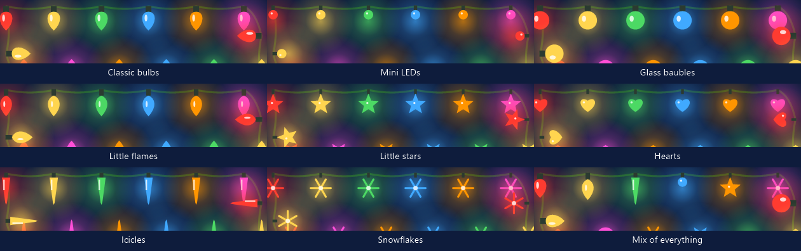

# 🎄 Weihnachtslichter für Windows

**Weihnachtslichter und Dekoration rund um den Rand deines Bildschirms, immer sichtbar im Infobereich. Klein, kostenlos und Open Source.**

[⬇️ Herunterladen](https://github.com/ericbruggema/kerstlampjes-windows/releases/latest/download/Kerstlampjes-Windows.exe) · [Android-Version](https://github.com/ericbruggema/kerstlampjes)

🌍 **Lies dies in:** [Nederlands](README.md) · [English](README.en.md) · **Deutsch** · [Français](README.fr.md) · [Español](README.es.md) · [中文](README.zh.md)

---

## 📸 Bilder

Die Bilder sind simuliert: der Zeichencode der App auf einem nachgebauten Windows-11-Desktop, mit englischer Oberfläche.

 Die Lichter bleiben am Rand, auch bei geöffnetem Startmenü

<table>
<tr>
<td align="center"> Das Menü im Infobereich</td>
<td align="center"> Einstellungen: Lichter</td>
<td align="center"> Einstellungen: Dekoration</td>
</tr>
</table>

 Zug von oben

 Zug von der Seite

 Girlande mit Kugeln und Lichtern

 Eiszapfen

 Liegenbleibender Schnee, Pinguine und Schneemann

 Schnee über den ganzen Bildschirm

 Schlitten mit Rentieren

 Laufschrift

 Farbpaletten

 Lampensorten

<table>
<tr>
<td align="center"> Raketen</td>
<td align="center"> Fontänen</td>
<td align="center"> Mörser</td>
</tr>
<tr>
<td align="center"> Römische Lichter</td>
<td align="center"> Feuerräder</td>
<td align="center"> Große Show</td>
</tr>
</table>

---

Eine kleine App nur mit den Lichtern: eine Kette am Rand deines Bildschirms (über der Taskleiste), immer sichtbar, und du kannst einfach hindurchklicken.

**Erste Schritte**

1. Lade [Kerstlampjes-Windows.exe](https://github.com/ericbruggema/kerstlampjes-windows/releases/latest/download/Kerstlampjes-Windows.exe) herunter und doppelklicke darauf. Nichts zu installieren; Windows 10 oder 11 genügt.
2. Suche das Glühbirnen-Symbol unten rechts neben der Uhr (manchmal hinter dem Pfeil ^).
3. **Linksklick** auf das Symbol schaltet die Lichter an oder aus. **Rechtsklick** öffnet das Menü:

| Menüpunkt | Was er macht |
|---|---|
| Lichter an | Schaltet die Lichter an oder aus |
| Einstellungen… | Effekt, Farben, Dekoration und mehr |
| Feuerwerk zünden · Eiszapfen fallen lassen · Schnee wegfegen | Schnellaktionen für die Dekoration |
| Mit Windows starten | Startet das Programm automatisch beim Hochfahren |
| Nach Updates suchen | Prüft auf GitHub, ob es eine neuere Version gibt |
| Über Weihnachtslichter… | Erklärung, Version und Lizenz |
| Beenden | Beendet das Programm |

- **Download:** [Kerstlampjes-Windows.exe](https://github.com/ericbruggema/kerstlampjes-windows/releases/latest/download/Kerstlampjes-Windows.exe) (100 kB, [Release](https://github.com/ericbruggema/kerstlampjes-windows/releases/latest)). Nichts zu installieren: Doppelklick, und das Symbol erscheint im Infobereich, unten rechts bei der Uhr.
- **An/aus:** Linksklick auf das Symbol. **Rechtsklick** öffnet das Menü: Einstellungen, mit Windows starten, nach Updates suchen, Über und Beenden.
- **Einstellungen:** Effekt (Dauerlicht, Funkeln, abwechselnd, Lauflicht, Farbwelle), Farben, Geschwindigkeit, Größe, Abstand, Eckenrundung, Randabstand, Durchhang, Deckkraft. Auch alle Bildschirme oder nur der Hauptbildschirm.
- **Dekoration:** dieselbe wie auf Android (kleiner Zug, Schnee, Feuerwerk, Eiszapfen, Girlande, Schlitten, Pinguine, Laufschrift), einzeln in den Einstellungen einzuschalten. Klicke auf Eiszapfen, Sternschnuppen, den Zug oder die Pinguine, dann reagieren sie; dein Klick geht trotzdem ans Fenster darunter.
- **Feuerwerksshow:** wähle zufälliges Feuerwerk oder eine Art: Raketen, Fontänen, Mörser, Römische Lichter, Feuerräder oder eine choreografierte große Show (etwa 32 Sekunden, danach eine Pause). Es geht an zufälligen Stellen am unteren Rand los; von Hand zünden geht über das Menü.
- **Schnee:** fällt standardmäßig an den Seiten; du kannst ihn auch über den ganzen Bildschirm fallen lassen. Die Option Kugeln an der Girlande ist erst wählbar, wenn die Girlande an ist.
- **Schnee entfernen:** fahre mit der Maus durch den Schnee, schüttle die Maus hin und her oder wähle im Menü *Schnee wegfegen*.
- **Nur auf dem Desktop:** eine Option, die Lichter nur zu zeigen, wenn du den Desktop siehst, nicht über Programmen.
- **Blendet sich aus** bei Vollbild-Apps (Spiele, Filme, Präsentationen).
- **Datenschutz:** nichts geht über das Internet, außer du wählst „Nach Updates suchen“. Einstellungen liegen in `%APPDATA%\Kerstlampjes`.
- **Sprachen:** folgt der Windows-Sprache (Nederlands, English, Deutsch, Français, Español, 中文).
- **Windows SmartScreen:** die Datei ist nicht digital signiert; bei der Warnung *Weitere Informationen* → *Trotzdem ausführen* wählen.
- **Bauen:** `dotnet build -c Release` (.NET Framework 4.8, in Windows 10/11 enthalten).

## 🤝 Open Source und Weiterverwendung

Kerstlampjes ist **Open Source und für alle frei nutzbar** unter der [MIT-Lizenz](LICENSE). Du darfst es kopieren,
ändern, teilen und sogar in deiner eigenen App verwenden. Der Code liegt hier: https://github.com/ericbruggema/kerstlampjes.

**Bitte nenne die Quelle.** Verwendest du Code oder Ideen aus diesem Projekt (zum Beispiel den Szenen-Editor, die
Randlichter oder das Partikelfeuer)? Dann verlinke bitte https://github.com/ericbruggema/kerstlampjes in deiner App, README oder Website. Die
MIT-Lizenz verlangt mindestens, dass der Copyright-Hinweis in [`LICENSE`](LICENSE) erhalten bleibt. Eine kurze
Zeile wie „Basiert auf Kerstlampjes, https://github.com/ericbruggema/kerstlampjes“ genügt.

Verbesserungen, Übersetzungen und Ideen sind willkommen über [Issues und Pull Requests](https://github.com/ericbruggema/kerstlampjes/issues). Die Fotos in
der App haben eigene Lizenzen, siehe unten.

---
