<div align="center">

# 🎄 Christmas Lights for Windows

**Christmas lights and festive decorations around the edge of your screen: a little train, snow, fireworks, icicles, a sleigh and more. Always visible, never in the way, controlled from the system tray.**

[](https://github.com/ericbruggema/kerstlampjes-windows/releases/latest)
[](LICENSE)


[⬇️ **Download Kerstlampjes-Windows.exe**](https://github.com/ericbruggema/kerstlampjes-windows/releases/latest/download/Kerstlampjes-Windows.exe) · [📱 Android version](https://github.com/ericbruggema/kerstlampjes)

🌍 **Read this in:** [Nederlands](README.md) · **English** · [Deutsch](README.de.md) · [Français](README.fr.md) · [Español](README.es.md) · [中文](README.zh.md)

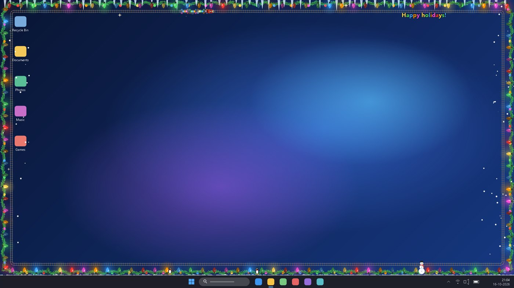

<sub>Simulated Windows 11 desktop: the app's own drawing code rendered on a mock desktop. All pictures in this README are made that way.</sub>

</div>

---

## Contents

1. [What is it?](#-what-is-it)
2. [Quick start](#-quick-start)
3. [The tray icon and menu](#-the-tray-icon-and-menu)
4. [Settings](#-settings)
5. [Decorations](#-decorations)
6. [Fireworks shows](#-fireworks-shows)
7. [Interacting with it](#-interacting-with-it)
8. [Effects, colours and the microphone](#-effects-colours-and-the-microphone)
9. [Screens, full-screen apps and desktop-only](#-screens-full-screen-apps-and-desktop-only)
10. [Privacy and permissions](#-privacy-and-permissions)
11. [Performance](#-performance)
12. [Frequently asked questions](#-frequently-asked-questions)
13. [Building from source](#-building-from-source)
14. [How it works](#-how-it-works)
15. [Open source and reuse](#-open-source-and-reuse)

---

## 🎅 What is it?

A tiny Windows program (about 120 kB, a single `.exe`, nothing to install) that draws a string of Christmas lights along the edge of your screen. On top of that you can switch on a whole set of extras, each one separately:

- 🚂 a **little train** that keeps going round, 🎄 a **garland**, 🧊 **icicles**, ❄️ **snow** that settles and can be swept away,
- 🎆 **fireworks** (rockets, fountains, mortars, Roman candles, Catherine wheels, or a choreographed grand show), ⭐ **shooting stars**,
- 🛷 a **sleigh with reindeer**, 🐧 **penguins and a snowman**, and a **scrolling text sign** with your own message.

It lives in the **system tray** (bottom right, next to the clock). From there you turn it on or off, change the settings and read about it. The lights are drawn in a transparent window that you can **click straight through**, that never takes focus, and that does not show up in the taskbar or in Alt-Tab.

It is the small sibling of the [Android app](https://github.com/ericbruggema/kerstlampjes), with the same look, the same effects and the same decorations.

> **Free and open source (MIT).** No ads, no account, no tracking. The only thing that ever goes over the internet is the update check, and only when you click it yourself.

<p align="center">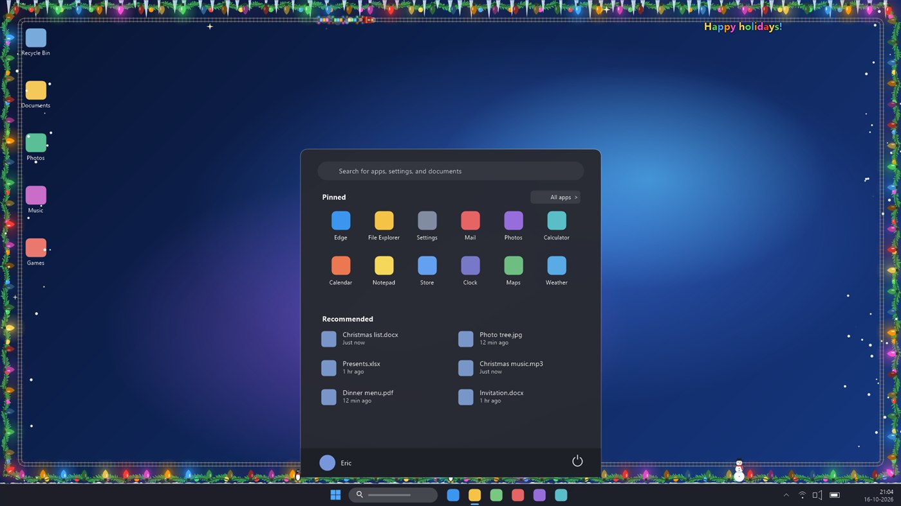<br><sub>The lights stay around the edge, also when the Start menu or any other window is open on top (unless you choose “only on the desktop”).</sub></p>

---

## 🚀 Quick start

1. **Download** [Kerstlampjes-Windows.exe](https://github.com/ericbruggema/kerstlampjes-windows/releases/latest/download/Kerstlampjes-Windows.exe) and double-click it. Nothing to install. You need Windows 10 (version 1903 or later) or Windows 11; both include the .NET Framework 4.8 that it runs on.
2. **Windows SmartScreen** may warn that the file is unknown, because it is not digitally signed (a certificate costs money). Choose **More info → Run anyway**. You can read all the code in this repository, or build the program yourself (see [Building from source](#-building-from-source)).
3. Look for the **light-bulb icon** at the bottom right, next to the clock. It may be hidden behind the ^ arrow; drag it onto the taskbar to keep it visible.
4. **Left-click** the icon to turn the lights on or off. **Right-click** it for the menu.
5. Open **Settings…** and switch on the decorations you like.

To start it automatically, tick **Start with Windows** in the tray menu.

---

## 🔔 The tray icon and menu

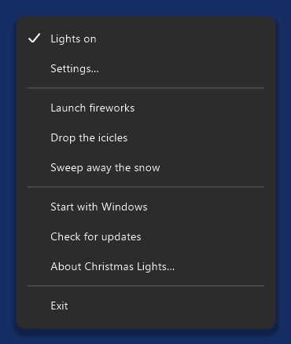

The icon is a small light bulb: coloured when the lights are on, grey when they are off.

| Action | What it does |
|---|---|
| **Left-click** the icon | Turns the lights on or off |
| **Right-click** the icon | Opens the menu |

| Menu item | What it does |
|---|---|
| **Lights on** | Turns the lights on or off (ticked when on) |
| **Settings…** | Opens the settings window |
| **Launch fireworks** | Starts the grand show, or one item of the chosen kind of fireworks |
| **Drop the icicles** | Lets all icicles fall at once (they grow back) |
| **Sweep away the snow** | Clears the settled snow |
| **Start with Windows** | Starts the program automatically when you log in |
| **Check for updates** | Looks on GitHub whether there is a newer version |
| **About Christmas Lights…** | Explanation, version, licence and a link to this repository |
| **Exit** | Stops the program |

<br clear="right">

---

## ⚙️ Settings

Every change takes effect immediately and is saved. There are two tabs.

<table>
<tr>
<td align="center">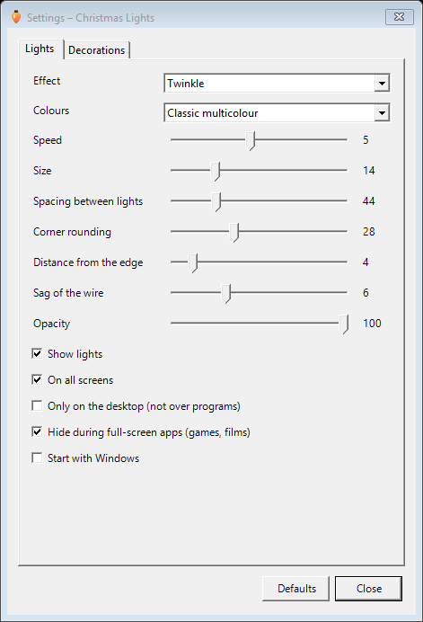<br><sub>Lights</sub></td>
<td align="center">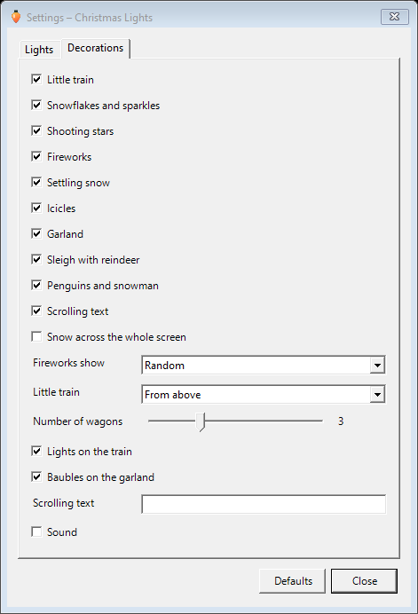<br><sub>Decorations</sub></td>
</tr>
</table>

### Lights tab

| Setting | What it does |
|---|---|
| **Effect** | Steady, Twinkle, Alternate blinking, Chasing light, Colour wave, or *To the music* (see below) |
| **Colours** | Classic multicolour, Warm white, Red / green / gold, Ice blue / white, Pink / purple |
| **Speed** | 1–10, how fast the effect runs |
| **Size** | Size of the bulbs (6–40) |
| **Spacing between lights** | Distance between bulbs (20–120) |
| **Corner rounding** | Rounds the corners of the string (0–80), so it follows your screen |
| **Distance from the edge** | How far the string sits from the screen edge (0–40) |
| **Sag of the wire** | How much the wire hangs between the bulbs (0–20) |
| **Opacity** | 30–100 %, makes everything more transparent |
| **Show lights** | Switch the string of lights off if you only want the decorations |
| **Only on the desktop (not over programs)** | Hides everything while another program is in front |
| **On all screens** | One string per monitor, or only on the main screen |
| **Hide during full-screen apps (games, films)** | Hides itself automatically; on by default |
| **Start with Windows** | Automatic start |

### Decorations tab

Tick the decorations you want. The extra options next to a decoration can only be chosen when that decoration is switched on.

| Setting | What it does |
|---|---|
| The ten decorations | See [Decorations](#-decorations) |
| **Snow across the whole screen** | Snow normally falls along the left and right edges only; this lets it fall everywhere |
| **Fireworks show** | Random, Rockets, Fountains, Mortars, Roman candles, Catherine wheels or Grand show |
| **Little train** | Seen from above (along the whole edge) or from the side (along the bottom edge) |
| **Number of wagons** | 1–8 |
| **Lights on the train** | Little twinkling lights on the wagons |
| **Baubles on the garland** | Hanging baubles (only when the garland is on) |
| **Scrolling text** | Your own text, up to 80 characters |
| **Sound** | Small synthesised sounds for the train whistle, fireworks and icicles; off by default |

The **Defaults** button puts everything back to how it was.

---

## 🎁 Decorations

Each decoration can be switched on or off separately.

### 🚂 Little train

A little train with a locomotive, puffing smoke, and 1 to 8 wagons full of presents. Seen **from above** it rides on a track along the whole edge of your screen and takes the corners with you. Seen **from the side** it rides along the bottom edge. Switch on *Lights on the train* for twinkling lights on every wagon. **Click the train** and it whistles.

<p align="center">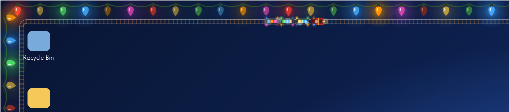<br><sub>From above, along the top edge</sub></p>

<p align="center">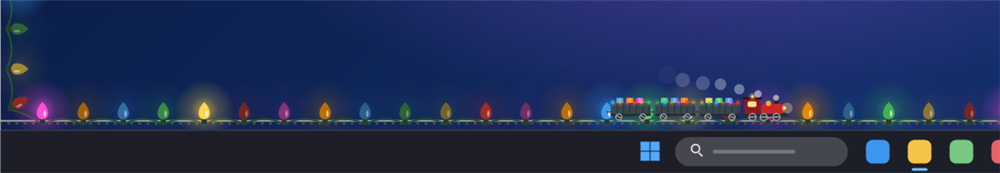<br><sub>From the side, along the bottom edge (just above the taskbar)</sub></p>

### 🎄 Garland

A green garland with needles hangs along the whole edge in swags, optionally with hanging **baubles**. Turn off *Show lights* if you want the garland without the string of lights, or keep both.

<p align="center">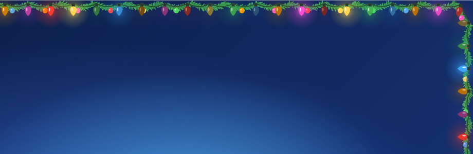</p>

### 🧊 Icicles

Icicles hang from the top edge, each a different length. **Click one** and it falls and is gone; after a while it grows back. They also drop by themselves now and then.

<p align="center">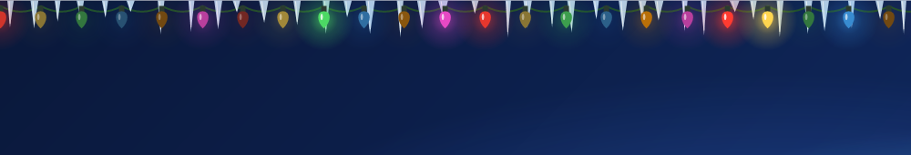</p>

### ❄️ Snowflakes and sparkles, ⭐ shooting stars

Snowflakes drift down along the sides of the screen, and little four-pointed stars twinkle in the corners. Now and then a **shooting star** crosses the screen: **click it** and it explodes in fireworks. The option *Snow across the whole screen* lets the snow fall over the entire desktop.

<p align="center"><br><sub>With “Snow across the whole screen”</sub></p>

### ☃️ Settling snow, 🐧 penguins and snowman

Snow slowly builds up along the bottom edge, right on top of your taskbar. Two **penguins** waddle back and forth over it and a **snowman** stands in the corner. Click a penguin and it hops; click the snowman and its scarf flutters.

The snow is easy to get rid of: **move your mouse through it** (like a snow plough), **shake your mouse** left and right a few times, or choose **Sweep away the snow** in the tray menu. Afterwards it builds up again.

<p align="center">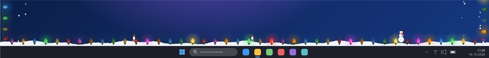<br><sub>Settled snow, penguins and a snowman along the bottom edge</sub></p>

### 🛷 Sleigh with reindeer

Every half minute or so Santa flies by with three reindeer (the front one has a glowing red nose) and leaves a trail of golden sparkles.

<p align="center">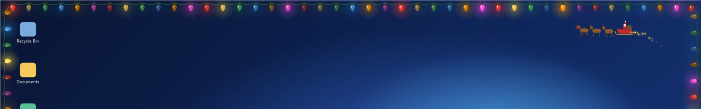</p>

### 🔤 Scrolling text

A scrolling sign in the colours of the lights, with your own text (the default is “Happy holidays!” in your language).

<p align="center">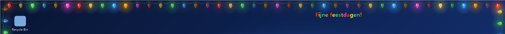</p>

---

## 🎆 Fireworks shows

Switch on **Fireworks** and choose a **Fireworks show**. Everything goes off at random moments from random spots along the bottom edge, and the fireworks are scaled to the size of your screen. The explosions come in several kinds: normal peony, ring, willow (golden sparks that fall slowly), double ring and even a heart.

| Show | What you get | |
|---|---|---|
| **Random** | A mix of everything, at random moments | |
| **Rockets** | Single rockets (sometimes two) | 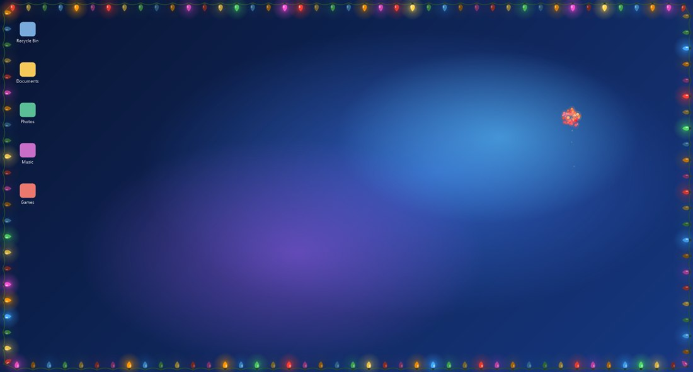 |
| **Fountains** | One to three fountains of sparks along the bottom edge | 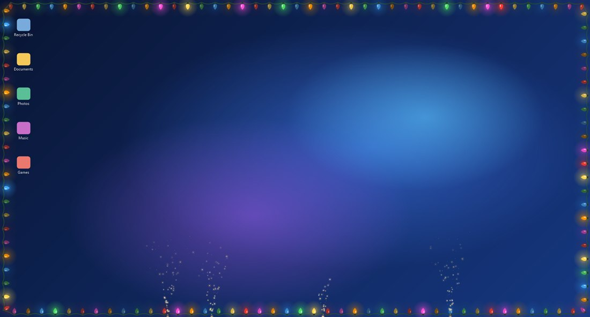 |
| **Mortars** | A volley of five shells from one spot | 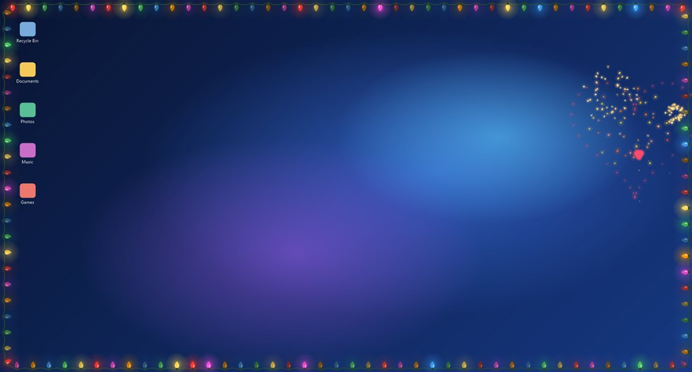 |
| **Roman candles** | A row of coloured shots, slanting upwards | 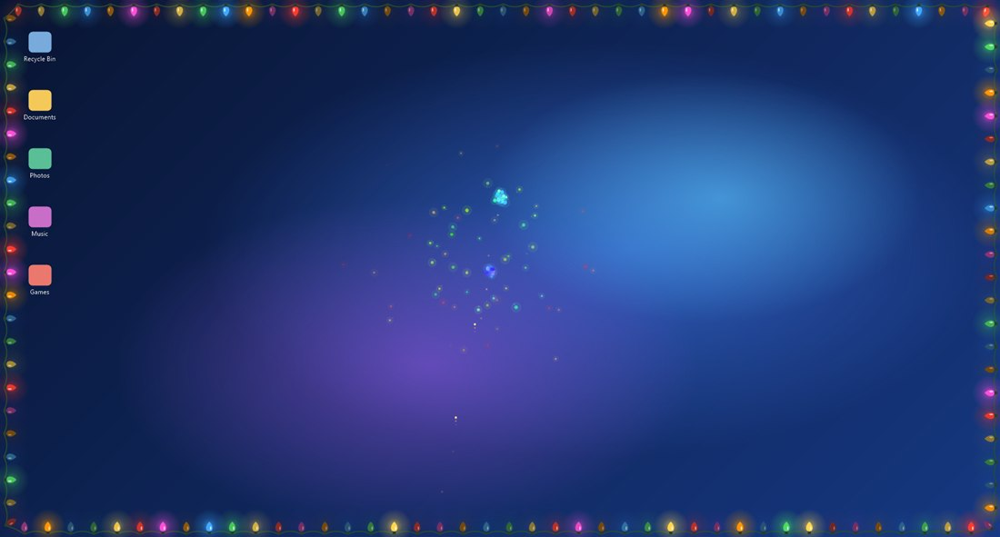 |
| **Catherine wheels** | Spinning wheels of sparks on the walls | 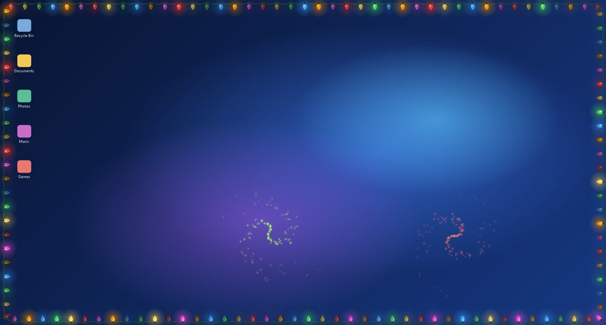 |
| **Grand show** | A choreographed show of about 32 seconds: fountains, mortars, wheels, a fan of rockets, candles, a barrage and a big finale, then a pause | 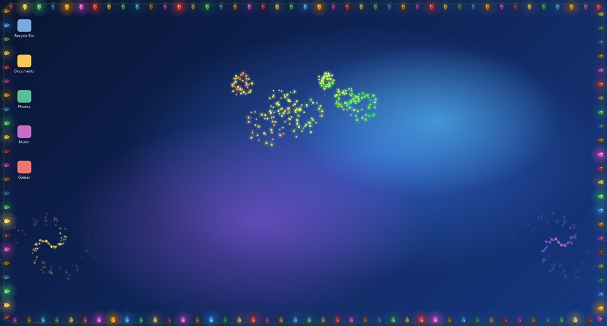 |

You can also start it by hand from the tray menu with **Launch fireworks**: that runs the grand show, or one item of the chosen kind.

---

## 🖱️ Interacting with it

The lights are drawn in a transparent window that lets **every click and keystroke through** to the window underneath. You can still interact with the decorations:

| You do | What happens |
|---|---|
| **Click** an icicle | It falls and grows back later |
| **Click** a shooting star | It explodes in fireworks |
| **Click** the train | It whistles and puffs |
| **Click** a penguin / the snowman | The penguin hops / the scarf flutters |
| **Move the mouse through the snow** | The snow is swept away around the cursor |
| **Shake the mouse** left and right | All the settled snow flies away |
| Tray menu | **Launch fireworks**, **Drop the icicles**, **Sweep away the snow** |

How is that possible without blocking clicks? The program only *listens* to where you press the left mouse button (a standard Windows “low-level mouse hook”). It does not swallow the click: your click always reaches the program underneath as usual. Positions are only compared with the decorations on screen; nothing is recorded or sent anywhere.

---

## 🎵 Effects, colours and the microphone

**Effects:** *Steady*, *Twinkle*, *Alternate blinking*, *Chasing light*, *Colour wave* and *To the music*.

**Colours:** five palettes.

<p align="center">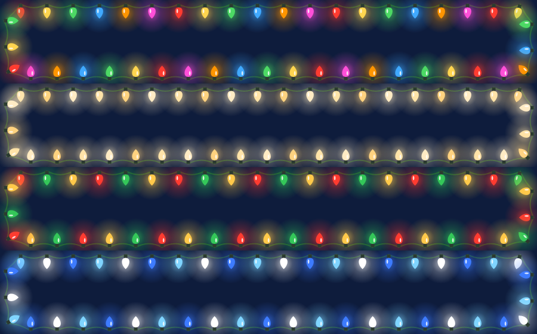<br><sub>Classic multicolour · Warm white · Red / green / gold · Ice blue / white (and Pink / purple)</sub></p>

**To the music** makes the lights react to sound picked up by your **microphone**: the louder it is, the more lights come on, each one with its own threshold. The program adjusts itself to the volume in the room.

- The microphone is only opened when you choose this effect *and* the lights are visible.
- Only the **volume** is measured. No audio is recorded, stored or sent.
- If Windows does not allow it, you get one message pointing to *Settings → Privacy & security → Microphone*.

---

## 🖥️ Screens, full-screen apps and desktop-only

- **Your taskbar stays free:** the lights follow the *usable area* of the screen, so with the taskbar at the bottom the string sits just above it (and on the side or top the string adapts).
- **Several monitors:** choose *On all screens* for one string per monitor, each with its own size and sharpness (the program is DPI-aware per monitor), or only the main screen.
- **Full-screen apps:** while a game, film or presentation runs full-screen, everything hides itself. You can turn this off with *Hide during full-screen apps*.
- **Only on the desktop:** with *Only on the desktop (not over programs)* the lights and decorations only show when you see the desktop, and disappear as soon as another program is in front.

---

## 🔐 Privacy and permissions

| What | Why | Needs your permission? |
|---|---|---|
| **Internet** | Only the update check, when *you* choose *Check for updates* (one request to the GitHub API of this repository) | No, but it only happens when you click |
| **Microphone** | Only for the effect *To the music*, to measure the volume. Nothing is recorded | Windows may ask / you can block it in its privacy settings |
| **Mouse position** | Only to react to clicks and mouse movements on the decorations (see above). Not recorded, not sent | – |
| **Registry** | Only if you tick *Start with Windows*: one entry in `HKCU\Software\Microsoft\Windows\CurrentVersion\Run` | Yes, you tick it |
| **Files** | Your settings in `%APPDATA%\Kerstlampjes\settings.ini` | – |

No account, no analytics, no ads. The program asks for no administrator rights.

---

## ⚡ Performance

The lights are pre-drawn and then only copied to the screen, so they are light on the processor. In my tests on a 1920 × 1080 screen:

| Situation | Processor use (of one core) |
|---|---|
| Lights, effect *Steady* | about 0 % (nothing is redrawn) |
| Lights, effect *Twinkle* | about 1–2 % |
| All decorations on | about 12 % |

Everything hides itself in full-screen apps, so games are not affected.

---

## ❓ Frequently asked questions

**Windows says “Windows protected your PC”. Is it safe?**
The file is not digitally signed, so SmartScreen does not know it. Choose *More info → Run anyway*. All the code is in this repository, and you can build the program yourself with one command and compare it.

**My antivirus complains.**
Unsigned programs that listen to the mouse (for the clicks on the decorations) are sometimes flagged by overly careful scanners. This program only reads where the left button is pressed; see [Privacy](#-privacy-and-permissions). You can check the source or build it yourself.

**Do the lights block my clicks?**
No. The window is fully click-through. You can work as usual.

**It disappeared!**
Look in the system tray (the ^ arrow). The lights hide themselves when you run a full-screen app, and, if you chose *Only on the desktop*, when a program is in front.

**I do not see the icon.**
Drag the icon out of the ^ overflow onto the taskbar. If it is not there at all, start the program again; a second start does nothing, because it is already running.

**How do I remove it?**
Choose *Exit* in the tray menu, untick *Start with Windows* first if you ticked it, and delete the `.exe` and the folder `%APPDATA%\Kerstlampjes`. There is no installer, so nothing else is left behind.

**Can I use it on Windows 7 / 8?**
It is made for Windows 10 and 11. It may work on older versions with the .NET Framework 4.8, but that is not tested.

**Which language does it use?**
That of Windows: Dutch, English, German, French, Spanish or Chinese; anything else shows English.

**Where is the Android version?**
At [github.com/ericbruggema/kerstlampjes](https://github.com/ericbruggema/kerstlampjes).

---

## 🛠️ Building from source

You need the [.NET SDK](https://dotnet.microsoft.com/download) (the program itself targets the .NET Framework 4.8 that is included in Windows 10/11). There are no other dependencies.

```bash
git clone https://github.com/ericbruggema/kerstlampjes-windows.git
cd kerstlampjes-windows
dotnet build Kerstlampjes.csproj -c Release -o out
out\Kerstlampjes.exe
```

| File | What is in it |
|---|---|
| `Program.cs` | The tray app: menu, overlays, mouse hook, update check, About window |
| `Overlay.cs` | The transparent click-through window (per-pixel alpha) and the Windows calls |
| `Lights.cs` | Draws the string of lights, with a sprite cache for the bulbs |
| `Decor.cs` | Train, garland, snow, icicles, shooting stars, sleigh, penguins, snowman, scrolling text |
| `Fireworks.cs` | The fireworks shows: rockets, fountains, mortars, candles, wheels, grand show |
| `Mic.cs` | Measures the microphone volume (winmm) |
| `Settings.cs` | The settings and how they are saved |
| `SettingsForm.cs` | The settings window |
| `Strings.cs` | Translations (the Dutch text is the key) |

A GitHub Actions workflow (`.github/workflows/windows.yml`) checks on every push that the program still builds.

---

## 🧩 How it works

- **A transparent, click-through window.** Each screen gets one borderless window with the styles *layered*, *transparent* (click-through), *tool window* (no taskbar or Alt-Tab entry), *no-activate* (never takes focus) and *topmost*. It is updated with `UpdateLayeredWindow`, which gives true per-pixel transparency.
- **Fast drawing.** The static parts (the wire, the garland and the track) are drawn once and copied into the window's bitmap each frame with a single memory copy. Every bulb (glow, socket, glass and shine) is pre-drawn per colour, brightness and angle and reused as a sprite, so a frame costs very little.
- **Clicks without blocking.** A low-level mouse hook reads where the left button goes down and the program checks that against the decorations. The hook always passes the click on.
- **Full-screen detection.** `SHQueryUserNotificationState` tells whether a full-screen app is running; the foreground window's class tells whether you are looking at the desktop.
- **Microphone.** `waveIn` (winmm) delivers short buffers; only their volume is used.
- **Settings and languages.** A simple `settings.ini`; the Dutch text is the key for the translations, like in the Android app.

---

## 🤝 Open source and reuse

Christmas Lights for Windows is **free and open source** under the **MIT licence** (see [`LICENSE`](LICENSE)). Copying, changing and sharing is welcome.

**Using code or ideas from this project?** Please add a **credit with a link** to this repository, in your app, on your website or in your README:

> https://github.com/ericbruggema/kerstlampjes-windows

(and, if you also use the Android code or ideas: https://github.com/ericbruggema/kerstlampjes). See [`NOTICE.md`](NOTICE.md). Issues, ideas and pull requests are welcome.
