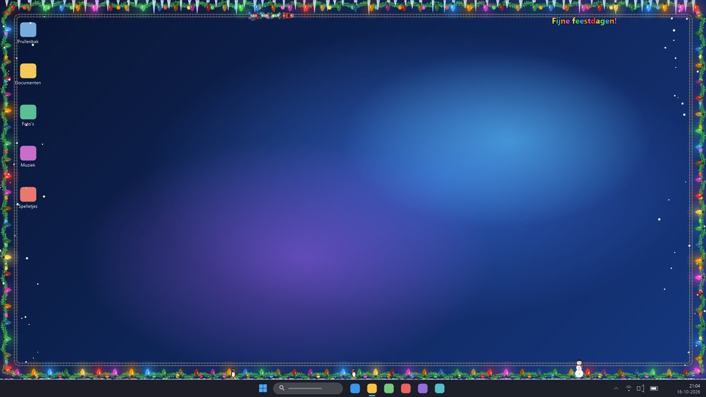
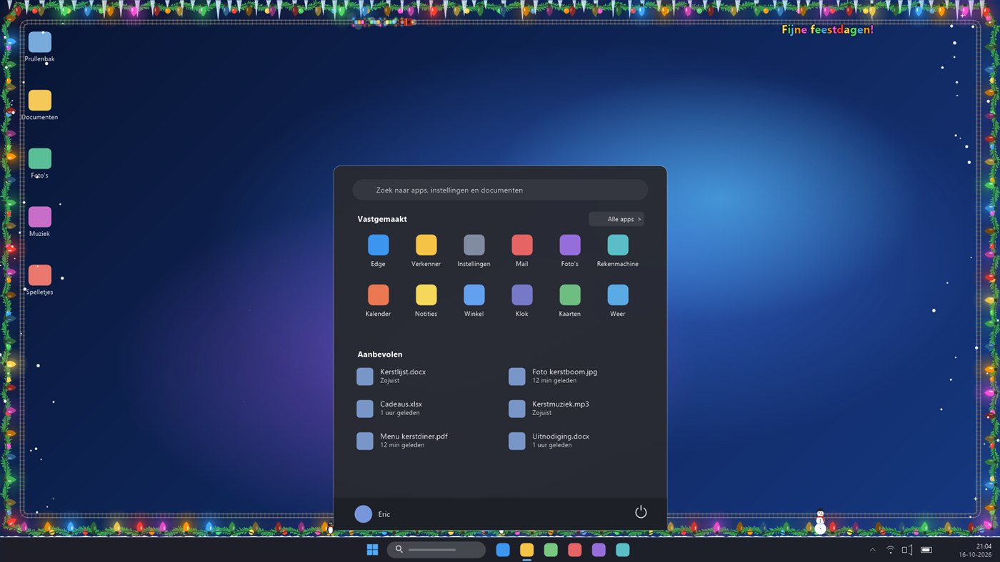
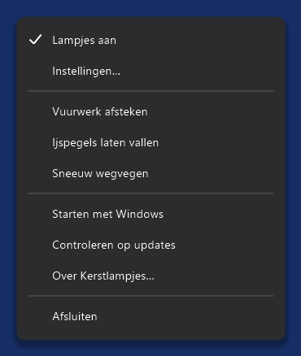
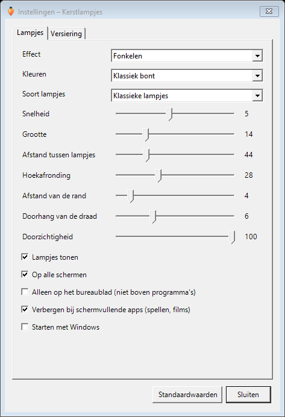
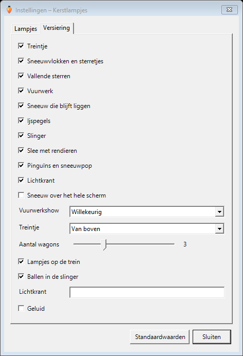
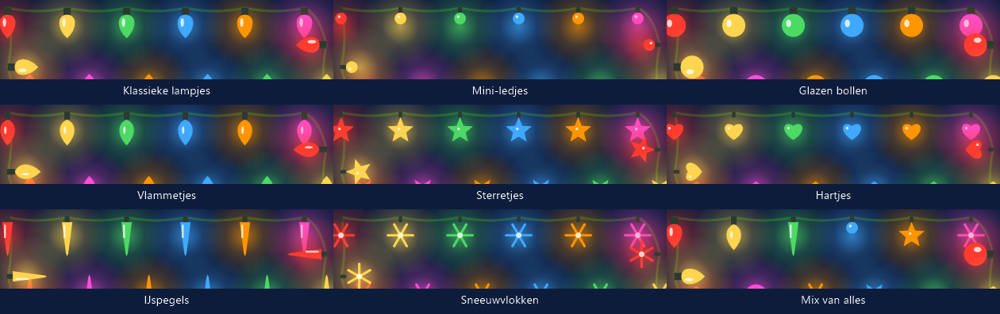

<div align="center">

# 🎄 Kerstlampjes voor Windows

**Kerstlampjes en feestelijke versiering rond de rand van je scherm: een treintje, sneeuw, vuurwerk, ijspegels, een slee en meer. Altijd zichtbaar, nooit in de weg en te bedienen vanuit het systeemvak.**

[](https://github.com/ericbruggema/kerstlampjes-windows/releases/latest)
[](LICENSE)


[⬇️ **Download Kerstlampjes-Windows.exe**](https://github.com/ericbruggema/kerstlampjes-windows/releases/latest/download/Kerstlampjes-Windows.exe) · [📱 Android-versie](https://github.com/ericbruggema/kerstlampjes)

🌍 **Lees dit in:** **Nederlands** · [English](README.en.md) · [Deutsch](README.de.md) · [Français](README.fr.md) · [Español](README.es.md) · [中文](README.zh.md)



<sub>Gesimuleerd Windows 11-bureaublad: de tekencode van de app zelf, getekend op een nagemaakt bureaublad. Alle afbeeldingen in deze README zijn zo gemaakt.</sub>

</div>

---

## Inhoud

1. [Wat is het?](#-wat-is-het)
2. [Snel starten](#-snel-starten)
3. [Het icoon en het menu](#-het-icoon-en-het-menu)
4. [Instellingen](#️-instellingen)
5. [Soorten lampjes](#-soorten-lampjes)
6. [Versiering](#-versiering)
7. [Vuurwerkshows](#-vuurwerkshows)
8. [Ermee spelen](#️-ermee-spelen)
9. [Effecten, kleuren en de microfoon](#-effecten-kleuren-en-de-microfoon)
10. [Schermen, schermvullende apps en alleen bureaublad](#️-schermen-schermvullende-apps-en-alleen-bureaublad)
11. [Privacy en rechten](#-privacy-en-rechten)
12. [Prestaties](#-prestaties)
13. [Veelgestelde vragen](#-veelgestelde-vragen)
14. [Bouwen uit de broncode](#️-bouwen-uit-de-broncode)
15. [Hoe het werkt](#-hoe-het-werkt)
16. [Open source en gebruik](#-open-source-en-gebruik)

---

## 🎅 Wat is het?

Een piepklein Windows-programma (zo'n 120 kB, één `.exe`, niets te installeren) dat een snoer kerstlampjes langs de rand van je scherm tekent. Daar kun je een hele reeks extra's bijzetten, ieder los aan of uit:

- 🚂 een **treintje** dat rondjes blijft rijden, 🎄 een **slinger**, 🧊 **ijspegels**, ❄️ **sneeuw** die blijft liggen en die je weg kunt vegen,
- 🎆 **vuurwerk** (pijlen, fonteinen, vuurpotten, Romeinse kaarsen, vuurraden of een gechoreografeerde grote show), ⭐ **vallende sterren**,
- 🛷 een **slee met rendieren**, 🐧 **pinguïns en een sneeuwman** en een **lichtkrant** met je eigen tekst.

Het woont in het **systeemvak** (rechtsonder, bij de klok). Daar zet je het aan of uit, pas je de instellingen aan en lees je erover. De lampjes worden getekend in een doorzichtig venster waar je **gewoon doorheen klikt**, dat nooit de focus pakt en dat niet in de taakbalk of in Alt-Tab verschijnt.

Het is de kleine broer van de [Android-app](https://github.com/ericbruggema/kerstlampjes), met hetzelfde uiterlijk, dezelfde effecten en dezelfde versiering.

> **Gratis en open source (MIT).** Geen reclame, geen account, geen tracking. Het enige wat ooit via internet gaat is de updatecontrole, en alleen als je zelf erop klikt.

<p align="center"><br><sub>De lampjes blijven rond de rand staan, ook als het startmenu of een ander venster erboven openstaat (tenzij je kiest voor “alleen op het bureaublad”).</sub></p>

---

## 🚀 Snel starten

1. **Download** [Kerstlampjes-Windows.exe](https://github.com/ericbruggema/kerstlampjes-windows/releases/latest/download/Kerstlampjes-Windows.exe) en dubbelklik erop. Er is niets te installeren. Je hebt Windows 10 (versie 1903 of nieuwer) of Windows 11 nodig; beide hebben het .NET Framework 4.8 al aan boord waarop het draait.
2. **Windows SmartScreen** kan waarschuwen dat het bestand onbekend is, omdat het niet digitaal is ondertekend (een certificaat kost geld). Kies **Meer info → Toch uitvoeren**. Je kunt alle code in deze repository lezen, of het programma zelf bouwen (zie [Bouwen uit de broncode](#️-bouwen-uit-de-broncode)).
3. Zoek het **lampje-icoon** rechtsonder bij de klok. Het kan achter het pijltje ^ zitten; sleep het naar de taakbalk om het zichtbaar te houden.
4. **Linkermuisknop** op het icoon zet de lampjes aan of uit. **Rechtermuisknop** opent het menu.
5. Open **Instellingen…** en zet de versiering aan die je mooi vindt.

Wil je dat het vanzelf start? Vink **Starten met Windows** aan in het menu.

---

## 🔔 Het icoon en het menu



Het icoon is een klein lampje: in kleur als de lampjes aan staan, grijs als ze uit staan.

| Actie | Wat het doet |
|---|---|
| **Linkermuisknop** op het icoon | Zet de lampjes aan of uit |
| **Rechtermuisknop** op het icoon | Opent het menu |

| Menu-item | Wat het doet |
|---|---|
| **Lampjes aan** | Zet de lampjes aan of uit (met een vinkje als ze aan staan) |
| **Instellingen…** | Opent het instellingenvenster |
| **Vuurwerk afsteken** | Start de grote show, of één onderdeel van het gekozen soort vuurwerk |
| **Ijspegels laten vallen** | Laat alle ijspegels in één keer vallen (ze groeien weer aan) |
| **Sneeuw wegvegen** | Haalt de sneeuw die ligt weg |
| **Starten met Windows** | Start het programma automatisch bij het inloggen |
| **Controleren op updates** | Kijkt op GitHub of er een nieuwere versie is |
| **Over Kerstlampjes…** | Uitleg, versie, licentie en een link naar deze repository |
| **Afsluiten** | Stopt het programma |

<br clear="right">

---

## ⚙️ Instellingen

Elke wijziging werkt meteen door en wordt bewaard. Er zijn twee tabbladen.

<table>
<tr>
<td align="center"><br><sub>Lampjes</sub></td>
<td align="center"><br><sub>Versiering</sub></td>
</tr>
</table>

### Tabblad Lampjes

| Instelling | Wat het doet |
|---|---|
| **Effect** | Vast aan, Fonkelen, Om en om knipperen, Lopend licht, Kleurgolf of *Op de muziek* (zie hieronder) |
| **Kleuren** | Klassiek bont, Warm wit, Rood / groen / goud, IJsblauw / wit, Roze / paars |
| **Soort lampjes** | Klassieke lampjes, Mini-ledjes, Glazen bollen, Vlammetjes, Sterretjes, Hartjes, IJspegels, Sneeuwvlokken of een mix van alles (zie [Soorten lampjes](#-soorten-lampjes)) |
| **Snelheid** | 1–10, hoe snel het effect loopt |
| **Grootte** | Grootte van de lampjes (6–40) |
| **Afstand tussen lampjes** | Afstand tussen de lampjes (20–120) |
| **Hoekafronding** | Rondt de hoeken van het snoer af (0–80), zodat het je scherm volgt |
| **Afstand van de rand** | Hoe ver het snoer van de schermrand hangt (0–40) |
| **Doorhang van de draad** | Hoeveel de draad tussen de lampjes doorhangt (0–20) |
| **Doorzichtigheid** | 30–100 %, maakt alles doorzichtiger |
| **Lampjes tonen** | Zet het snoer uit als je alleen de versiering wilt |
| **Alleen op het bureaublad (niet boven programma's)** | Verbergt alles zolang een ander programma voorop staat |
| **Op alle schermen** | Eén snoer per monitor, of alleen op het hoofdscherm |
| **Verbergen bij schermvullende apps (spellen, films)** | Verbergt zichzelf automatisch; staat standaard aan |
| **Starten met Windows** | Automatisch starten |

### Tabblad Versiering

Vink de versiering aan die je wilt. De extra opties bij een onderdeel zijn pas te kiezen als dat onderdeel aan staat.

| Instelling | Wat het doet |
|---|---|
| De tien onderdelen | Zie [Versiering](#-versiering) |
| **Sneeuw over het hele scherm** | Sneeuw valt normaal alleen langs de linker- en rechterrand; dit laat hem overal vallen |
| **Vuurwerkshow** | Willekeurig, Pijlen, Fonteinen, Vuurpotten, Romeinse kaarsen, Vuurraden of Grote show |
| **Treintje** | Van boven gezien (langs de hele rand) of van opzij (langs de onderrand) |
| **Aantal wagons** | 1–8 |
| **Lampjes op de trein** | Twinkelende lampjes op de wagons |
| **Ballen in de slinger** | Hangende ballen (alleen als de slinger aan staat) |
| **Lichtkrant** | Je eigen tekst, maximaal 80 tekens |
| **Geluid** | Kleine, zelf gesynthetiseerde geluidjes voor de treinfluit, het vuurwerk en de ijspegels; staat standaard uit |

Met de knop **Standaardwaarden** zet je alles terug.

---

## 💡 Soorten lampjes

Kies **Soort lampjes** op het tabblad Lampjes. Er zijn acht vormen, plus een mix waarbij elk lampje een andere krijgt. Elke soort werkt met elk effect, elk kleurenpalet en elke grootte-instelling.

<p align="center"></p>

| Soort | Uiterlijk |
|---|---|
| **Klassieke lampjes** | De bekende peervormige kerstlamp |
| **Mini-ledjes** | Kleine, ronde ledjes dicht bij elkaar |
| **Glazen bollen** | Grote, ronde glazen ballen |
| **Vlammetjes** | Druppelvormige vlammetjes |
| **Sterretjes** | Sterren met vijf punten |
| **Hartjes** | Kleine hartjes |
| **IJspegels** | Lange, spitse ijspegellampjes |
| **Sneeuwvlokken** | Sneeuwvlokken met zes armen |
| **Mix van alles** | Een andere vorm voor elk lampje |

---

## 🎁 Versiering

Elk onderdeel is los aan of uit te zetten.

### 🚂 Treintje

Een treintje met een locomotief die rookwolkjes uitpuft, en 1 tot 8 wagons vol cadeautjes. **Van boven gezien** rijdt het over een spoor langs de hele rand van je scherm en neemt het de hoeken mee. **Van opzij gezien** rijdt het langs de onderrand. Zet *Lampjes op de trein* aan voor twinkelende lampjes op elke wagon. **Klik op de trein** en hij fluit.

<p align="center"><br><sub>Van boven gezien, langs de bovenrand</sub></p>

<p align="center"><br><sub>Van opzij gezien, langs de onderrand (net boven de taakbalk)</sub></p>

### 🎄 Slinger

Een groene slinger met naaldjes hangt in bogen langs de hele rand, desgewenst met hangende **ballen**. Zet *Lampjes tonen* uit als je de slinger zonder het snoer lampjes wilt, of houd allebei.

<p align="center"></p>

### 🧊 Ijspegels

Langs de bovenrand hangen ijspegels van verschillende lengte. **Klik op een ijspegel** en hij valt en is weg; na een tijdje groeit hij weer aan. Ze vallen af en toe ook vanzelf.

<p align="center"></p>

### ❄️ Sneeuwvlokken en sterretjes, ⭐ vallende sterren

Langs de zijkanten van het scherm dwarrelen sneeuwvlokken en in de hoeken twinkelen kleine sterretjes met vier punten. Af en toe schiet er een **vallende ster** over het scherm: **klik erop** en hij ontploft in vuurwerk. Met de optie *Sneeuw over het hele scherm* valt de sneeuw over je hele bureaublad.

<p align="center"><br><sub>Met “Sneeuw over het hele scherm”</sub></p>

### ☃️ Sneeuw die blijft liggen, 🐧 pinguïns en sneeuwman

Langs de onderrand bouwt zich langzaam sneeuw op, precies bovenop je taakbalk. Twee **pinguïns** waggelen er heen en weer en in de hoek staat een **sneeuwman**. Klik op een pinguïn en hij springt; klik op de sneeuwman en zijn sjaal wappert.

De sneeuw is makkelijk kwijt te raken: **beweeg je muis erdoorheen** (als een sneeuwschuiver), **schud je muis** een paar keer heen en weer, of kies **Sneeuw wegvegen** in het menu. Daarna bouwt hij zich weer op.

<p align="center"><br><sub>Sneeuw die blijft liggen, pinguïns en een sneeuwman langs de onderrand</sub></p>

### 🛷 Slee met rendieren

Zo'n elke halve minuut vliegt de kerstman voorbij met drie rendieren (het voorste heeft een gloeiende rode neus) en laat hij een spoor van gouden vonkjes achter.

<p align="center"></p>

### 🔤 Lichtkrant

Een lichtkrant in de kleuren van de lampjes, met je eigen tekst (standaard “Fijne feestdagen!” in jouw taal).

<p align="center"></p>

---

## 🎆 Vuurwerkshows

Zet **Vuurwerk** aan en kies een **Vuurwerkshow**. Alles gaat af op willekeurige momenten vanaf willekeurige plekken langs de onderrand, en het vuurwerk schaalt mee met de grootte van je scherm. De knallen zijn er in meerdere soorten: gewone pioenroos, ring, treurwilg (gouden vonken die langzaam vallen), dubbele ring en zelfs een hartje.

| Show | Wat je krijgt | |
|---|---|---|
| **Willekeurig** | Een mix van alles, op willekeurige momenten | |
| **Pijlen** | Losse pijlen (soms twee) |  |
| **Fonteinen** | Eén tot drie vonkenfonteinen langs de onderrand |  |
| **Vuurpotten** | Een salvo van vijf schoten vanaf één plek |  |
| **Romeinse kaarsen** | Een reeks gekleurde schoten, schuin omhoog |  |
| **Vuurraden** | Draaiende wielen van vonken aan de wanden |  |
| **Grote show** | Een gechoreografeerde show van zo'n 32 seconden: fonteinen, vuurpotten, vuurraden, een waaier van pijlen, kaarsen, een salvo en een grote finale, daarna een pauze |  |

Je kunt ook zelf afsteken via het menu met **Vuurwerk afsteken**: dat draait de grote show, of één onderdeel van het gekozen soort.

---

## 🖱️ Ermee spelen

De lampjes worden getekend in een doorzichtig venster dat **elke klik en toetsaanslag doorlaat** naar het venster eronder. Toch kun je met de versiering spelen:

| Jij doet | Dit gebeurt |
|---|---|
| **Klik** op een ijspegel | Hij valt en groeit later weer aan |
| **Klik** op een vallende ster | Hij ontploft in vuurwerk |
| **Klik** op de trein | Hij fluit en puft |
| **Klik** op een pinguïn / de sneeuwman | De pinguïn springt / de sjaal wappert |
| **Beweeg de muis door de sneeuw** | De sneeuw wordt rond de muisaanwijzer weggeveegd |
| **Schud de muis** heen en weer | Alle sneeuw die ligt vliegt weg |
| Menu | **Vuurwerk afsteken**, **Ijspegels laten vallen**, **Sneeuw wegvegen** |

Hoe kan dat zonder klikken tegen te houden? Het programma *luistert* alleen mee waar je de linkermuisknop indrukt (een standaard Windows “low-level mouse hook”). Het houdt de klik niet tegen: je klik komt altijd gewoon aan bij het programma eronder. De posities worden alleen vergeleken met de versiering op het scherm; er wordt niets opgeslagen of verstuurd.

---

## 🎵 Effecten, kleuren en de microfoon

**Effecten:** *Vast aan*, *Fonkelen*, *Om en om knipperen*, *Lopend licht*, *Kleurgolf* en *Op de muziek*.

**Kleuren:** vijf paletten.

<p align="center"><br><sub>Klassiek bont · Warm wit · Rood / groen / goud · IJsblauw / wit (en Roze / paars)</sub></p>

**Op de muziek** laat de lampjes reageren op geluid dat je **microfoon** opvangt: hoe harder, hoe meer lampjes er aangaan, elk met een eigen drempel. Het programma past zich aan het volume in de kamer aan.

- De microfoon gaat alleen open als je dit effect kiest *en* de lampjes zichtbaar zijn.
- Er wordt alleen het **volume** gemeten. Er wordt geen geluid opgenomen, bewaard of verstuurd.
- Staat Windows het niet toe, dan krijg je één melding die wijst naar *Instellingen → Privacy en beveiliging → Microfoon*.

---

## 🖥️ Schermen, schermvullende apps en alleen bureaublad

- **Je taakbalk blijft vrij:** de lampjes volgen het *bruikbare gedeelte* van het scherm. Met de taakbalk onderaan hangt het snoer er net boven (en aan de zijkant of bovenkant past het snoer zich aan).
- **Meerdere monitoren:** kies *Op alle schermen* voor één snoer per monitor, elk met een eigen grootte en scherpte (het programma is DPI-bewust per monitor), of alleen het hoofdscherm.
- **Schermvullende apps:** zolang een spel, film of presentatie schermvullend draait, verbergt alles zichzelf. Je kunt dit uitzetten met *Verbergen bij schermvullende apps*.
- **Alleen op het bureaublad:** met *Alleen op het bureaublad (niet boven programma's)* zie je de lampjes en de versiering alleen als je het bureaublad ziet, en verdwijnen ze zodra een ander programma voorop staat.

---

## 🔐 Privacy en rechten

| Wat | Waarvoor | Toestemming nodig? |
|---|---|---|
| **Internet** | Alleen de updatecontrole, als *jij* *Controleren op updates* kiest (één verzoek aan de GitHub-API van deze repository) | Nee, maar het gebeurt alleen als je erop klikt |
| **Microfoon** | Alleen voor het effect *Op de muziek*, om het volume te meten. Er wordt niets opgenomen | Windows kan erom vragen / je kunt het blokkeren in de privacy-instellingen |
| **Muispositie** | Alleen om te reageren op klikken en muisbewegingen bij de versiering (zie hierboven). Niet opgeslagen, niet verstuurd | – |
| **Register** | Alleen als je *Starten met Windows* aanvinkt: één waarde in `HKCU\Software\Microsoft\Windows\CurrentVersion\Run` | Ja, je vinkt het zelf aan |
| **Bestanden** | Je instellingen in `%APPDATA%\Kerstlampjes\settings.ini` | – |

Geen account, geen analyse, geen reclame. Het programma vraagt geen beheerdersrechten.

---

## ⚡ Prestaties

De lampjes worden vooraf getekend en daarna alleen naar het scherm gekopieerd, dus ze belasten de processor weinig. In mijn tests op een scherm van 1920 × 1080:

| Situatie | Processorgebruik (van één kern) |
|---|---|
| Lampjes, effect *Vast aan* | ongeveer 0 % (er wordt niets opnieuw getekend) |
| Lampjes, effect *Fonkelen* | ongeveer 1–2 % |
| Alle versiering aan | ongeveer 12 % |

Bij schermvullende apps verbergt alles zichzelf, dus spellen merken er niets van.

---

## ❓ Veelgestelde vragen

**Windows zegt “Windows heeft uw pc beschermd”. Is het veilig?**
Het bestand is niet digitaal ondertekend, dus SmartScreen kent het niet. Kies *Meer info → Toch uitvoeren*. Alle code staat in deze repository, en je kunt het programma met één commando zelf bouwen en vergelijken.

**Mijn antivirus klaagt.**
Niet-ondertekende programma's die meeluisteren met de muis (voor de klikken op de versiering) worden soms aangemerkt door te voorzichtige scanners. Dit programma leest alleen waar de linkermuisknop wordt ingedrukt; zie [Privacy](#-privacy-en-rechten). Je kunt de broncode nalezen of zelf bouwen.

**Houden de lampjes mijn klikken tegen?**
Nee. Het venster is volledig doorklikbaar. Je kunt gewoon werken.

**Het is verdwenen!**
Kijk in het systeemvak (het pijltje ^). De lampjes verbergen zichzelf als je een schermvullende app draait, en, als je *Alleen op het bureaublad* koos, zodra een programma voorop staat.

**Ik zie het icoon niet.**
Sleep het icoon uit het pijltje ^ naar de taakbalk. Is het er helemaal niet, start het programma dan opnieuw; een tweede start doet niets, omdat het al draait.

**Hoe verwijder ik het?**
Kies *Afsluiten* in het menu, haal eerst het vinkje bij *Starten met Windows* weg als je dat had aangezet, en verwijder de `.exe` en de map `%APPDATA%\Kerstlampjes`. Er is geen installatieprogramma, dus er blijft verder niets achter.

**Werkt het op Windows 7 / 8?**
Het is gemaakt voor Windows 10 en 11. Op oudere versies werkt het misschien met het .NET Framework 4.8, maar dat is niet getest.

**Welke taal gebruikt het?**
Die van Windows: Nederlands, English, Deutsch, Français, Español of 中文; andere talen tonen Engels.

**Waar is de Android-versie?**
Op [github.com/ericbruggema/kerstlampjes](https://github.com/ericbruggema/kerstlampjes).

---

## 🛠️ Bouwen uit de broncode

Je hebt de [.NET SDK](https://dotnet.microsoft.com/download) nodig (het programma zelf richt zich op het .NET Framework 4.8 dat in Windows 10/11 zit). Er zijn geen andere afhankelijkheden.

```bash
git clone https://github.com/ericbruggema/kerstlampjes-windows.git
cd kerstlampjes-windows
dotnet build Kerstlampjes.csproj -c Release -o out
out\Kerstlampjes.exe
```

| Bestand | Wat erin zit |
|---|---|
| `Program.cs` | De tray-app: menu, overlays, muishaak, updatecontrole, Over-venster |
| `Overlay.cs` | Het doorzichtige, doorklikbare venster (per-pixel alpha) en de Windows-aanroepen |
| `Lights.cs` | Tekent het snoer lampjes, met een sprite-cache voor de lampjes |
| `Decor.cs` | Trein, slinger, sneeuw, ijspegels, vallende sterren, slee, pinguïns, sneeuwman, lichtkrant |
| `Fireworks.cs` | De vuurwerkshows: pijlen, fonteinen, vuurpotten, kaarsen, raden, grote show |
| `Mic.cs` | Meet het volume van de microfoon (winmm) |
| `Settings.cs` | De instellingen en hoe ze worden bewaard |
| `SettingsForm.cs` | Het instellingenvenster |
| `Strings.cs` | Vertalingen (de Nederlandse tekst is de sleutel) |

Een GitHub Actions-workflow (`.github/workflows/windows.yml`) controleert bij elke push dat het programma nog bouwt.

---

## 🧩 Hoe het werkt

- **Een doorzichtig, doorklikbaar venster.** Elk scherm krijgt één randloos venster met de stijlen *layered*, *transparent* (doorklikbaar), *tool window* (geen taakbalk- of Alt-Tab-item), *no-activate* (pakt nooit de focus) en *topmost*. Het wordt bijgewerkt met `UpdateLayeredWindow`, wat echte per-pixel doorzichtigheid geeft.
- **Snel tekenen.** De vaste delen (de draad, de slinger en het spoor) worden één keer getekend en elk beeld met één geheugenkopie in de bitmap van het venster gezet. Elk lampje (gloed, fitting, glas en glimlicht) wordt per kleur, helderheid en hoek vooraf getekend en als sprite hergebruikt, zodat een beeld weinig kost.
- **Klikken zonder tegen te houden.** Een low-level muishaak leest waar de linkermuisknop omlaag gaat en het programma vergelijkt dat met de versiering. De haak geeft de klik altijd door.
- **Schermvullend herkennen.** `SHQueryUserNotificationState` zegt of er een schermvullende app draait; de klasse van het voorgrondvenster zegt of je naar het bureaublad kijkt.
- **Microfoon.** `waveIn` (winmm) levert korte buffers; alleen het volume wordt gebruikt.
- **Instellingen en talen.** Een eenvoudige `settings.ini`; de Nederlandse tekst is de sleutel voor de vertalingen, net als in de Android-app.

---

## 🤝 Open source en gebruik

Kerstlampjes voor Windows is **gratis en open source** onder de **MIT-licentie** (zie [`LICENSE`](LICENSE)). Kopiëren, aanpassen en delen is welkom.

**Gebruik je code of ideeën uit dit project?** Zet dan een **vermelding met een link** naar deze repository, in je app, op je website of in je README:

> https://github.com/ericbruggema/kerstlampjes-windows

(en, als je ook de Android-code of -ideeën gebruikt: https://github.com/ericbruggema/kerstlampjes). Zie [`NOTICE.md`](NOTICE.md). Meldingen, ideeën en pull requests zijn welkom.
