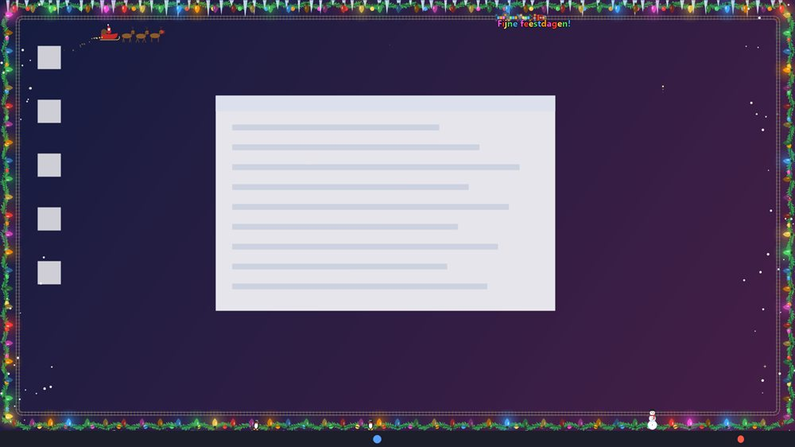
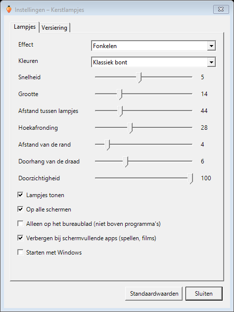

# 🎄 Kerstlampjes voor Windows

**Kerstlampjes en versiering rond de rand van je scherm, altijd zichtbaar in het systeemvak. Klein, gratis en open source.**

[⬇️ Download](https://github.com/ericbruggema/kerstlampjes-windows/releases/latest/download/Kerstlampjes-Windows.exe) · [Android-versie](https://github.com/ericbruggema/kerstlampjes)

🌍 **Lees dit in:** **Nederlands** · [English](README.en.md) · [Deutsch](README.de.md) · [Français](README.fr.md) · [Español](README.es.md) · [中文](README.zh.md)

---

Een kleine app met alleen de lampjes: een snoer langs de rand van je scherm (boven de taakbalk), altijd zichtbaar en je kunt er gewoon doorheen klikken.

 Gesimuleerd bureaublad: zo ziet de rand er op Windows uit, met alle versiering aan.

**Aan de slag**

1. Download [Kerstlampjes-Windows.exe](https://github.com/ericbruggema/kerstlampjes-windows/releases/latest/download/Kerstlampjes-Windows.exe) en dubbelklik erop. Er is niets te installeren; Windows 10 of 11 is genoeg.
2. Zoek het lampje-icoon rechtsonder bij de klok (soms achter het pijltje ^).
3. **Linkermuisknop** op het icoon zet de lampjes aan of uit. **Rechtermuisknop** opent het menu:

| Menu-item | Wat het doet |
|---|---|
| Lampjes aan | Zet de lampjes aan of uit |
| Instellingen… | Effect, kleuren, versiering en meer |
| Vuurwerk afsteken · Ijspegels laten vallen · Sneeuw wegvegen | Snelle acties voor de versiering |
| Starten met Windows | Start het programma automatisch bij het opstarten |
| Controleren op updates | Kijkt op GitHub of er een nieuwere versie is |
| Over Kerstlampjes… | Uitleg, versie en licentie |
| Afsluiten | Stopt het programma |

- **Downloaden:** [Kerstlampjes-Windows.exe](https://github.com/ericbruggema/kerstlampjes-windows/releases/latest/download/Kerstlampjes-Windows.exe) (100 kB, [release](https://github.com/ericbruggema/kerstlampjes-windows/releases/latest)). Niets te installeren: dubbelklik en het icoon verschijnt in het systeemvak, rechtsonder bij de klok.
- **Aan/uit:** linkermuisknop op het icoon. **Rechtermuisknop** geeft het menu: instellingen, starten met Windows, controleren op updates, over en afsluiten.
- **Instellingen:** effect (vast, fonkelen, om en om, lopend licht, kleurgolf), kleuren, snelheid, grootte, afstand, hoekafronding, afstand van de rand, doorhang, doorzichtigheid. Ook alle schermen of alleen het hoofdscherm.
- **Versiering:** dezelfde als op Android (treintje, sneeuw, vuurwerk, ijspegels, slinger, slee, pinguïns, lichtkrant), apart aan te zetten in de instellingen. Klik op ijspegels, vallende sterren, de trein of de pinguïns en ze reageren; je klik gaat daarna gewoon door naar het venster eronder.
- **Vuurwerkshow:** kies willekeurig vuurwerk of een soort: pijlen, fonteinen, vuurpotten, Romeinse kaarsen, vuurraden of een gechoreografeerde grote show (ongeveer 32 seconden, daarna een pauze). Het gaat af op willekeurige plekken langs de onderrand; handmatig afsteken kan via het menu.
- **Sneeuw:** valt standaard aan de zijkanten; je kunt hem ook over het hele scherm laten vallen. De optie voor ballen in de slinger is pas te kiezen als de slinger aan staat.
- **Sneeuw weghalen:** beweeg je muis door de sneeuw, schud je muis heen en weer, of kies *Sneeuw wegvegen* in het menu.
- **Alleen op het bureaublad:** optie om de lampjes alleen te tonen als je het bureaublad ziet, niet boven programma's.
- **Verbergt zichzelf** bij schermvullende apps (spellen, films, presentaties).
- **Privacy:** niets via internet, behalve als je zelf "Controleren op updates" kiest. Instellingen staan in `%APPDATA%\Kerstlampjes`.
- **Talen:** volgt de taal van Windows (Nederlands, English, Deutsch, Français, Español, 中文).
- **Windows SmartScreen:** het bestand is niet digitaal ondertekend; kies bij de waarschuwing *Meer info* → *Toch uitvoeren*.
- **Bouwen:** `dotnet build -c Release` (.NET Framework 4.8, zit in Windows 10/11).

## 🤝 Open source en gebruik

Kerstlampjes is **open source en vrij voor iedereen te gebruiken** onder de [MIT-licentie](LICENSE). Kopiëren,
aanpassen, delen en zelfs gebruiken in je eigen app mag. De code staat hier: https://github.com/ericbruggema/kerstlampjes.

**Graag een vermelding.** Gebruik je code of ideeën uit dit project (bijvoorbeeld de eigen-scène-editor, de
randlampjes of het deeltjesvuur)? Zet dan een verwijzing naar https://github.com/ericbruggema/kerstlampjes in je app, README of op je website. De
MIT-licentie vraagt in elk geval om het behouden van de copyright-vermelding in [`LICENSE`](LICENSE). Een korte
tekst als "Gebaseerd op Kerstlampjes, https://github.com/ericbruggema/kerstlampjes" is genoeg.

Verbeteringen, vertalingen en ideeën zijn welkom via [issues en pull requests](https://github.com/ericbruggema/kerstlampjes/issues). De foto's in de
app hebben hun eigen licentie, zie hieronder.

---
